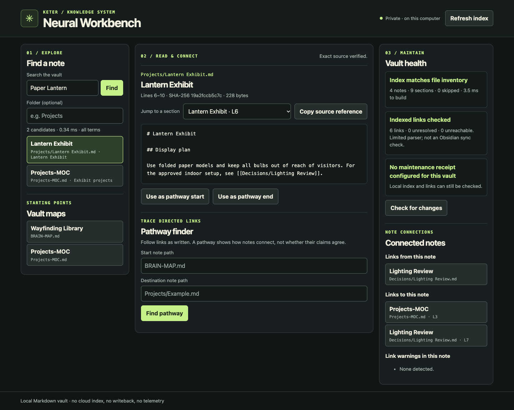

# Keter Agent Starter

A clean, installable Hermes Agent profile and a local Markdown Workbench. It demonstrates the assistant's evidence-first workflow without cloning anyone's history, identity details, accounts, or runtime. The example vault is a fictional library exhibit.

## Try the Workbench (no model or account required)

Use Python 3.9+ with SQLite FTS5 on macOS or Linux. The Workbench has no third-party Python or browser dependencies. From the repository root:

```sh
python3 workbench/workbench.py --vault examples/vault serve
```

Open the private localhost address printed by the server; keep the terminal running. Don't share that address. Search for `Paper Lantern`, open **Lantern Exhibit**, jump to **Display plan**, and follow the **Lighting Review** link. You can also use the Pathway finder to trace `BRAIN-MAP.md` → `Decisions/Lighting Review.md`. The health view checks the selected local folder, not sync. Use Ctrl-C to stop the server. Use a separate folder for your own notes; the sample folder can be updated by the distribution.

### Screenshots from the fictional demo



- [Follow a pathway to a decision note](docs/screenshots/02-pathway.png)
- [Inspect local index and link health](docs/screenshots/03-local-health.png)

```sh
python3 workbench/workbench.py --vault examples/vault search 'Paper Lantern' --limit 5
python3 workbench/workbench.py --vault examples/vault path BRAIN-MAP.md 'Decisions/Lighting Review.md'
python3 workbench/workbench.py --vault examples/vault health
```

For a search-derived excerpt, use `read 'Projects/Lantern Exhibit.md' --line N --sha256 DIGEST --chars 4500` on the same command, replacing `N` and `DIGEST` with the chosen result's values. If the note changed, search again. Obsidian is optional: it can edit the same Markdown, while the Workbench reads it. Use **Refresh index** after edits.

## Install the assistant profile

Install Hermes Agent separately, using a release with profile distribution support (manifest minimum: 0.23.0). Review [`distribution.yaml`](distribution.yaml), then run these commands from a clean checkout:

```sh
hermes profile install .
hermes -p keter-starter setup model
hermes -p keter-starter chat
```

Use a new name with `--name` if you already have that profile; do not force-overwrite it. Configure a provider you are authorized to use. No provider, credentials, schedules, messaging channels, or live integrations are bundled. The install copies the starter identity, skill, Workbench code, and fictional vault into the new profile. The Workbench still runs separately as a CLI or browser app. In chat, give the assistant the exact path of the sample vault and ask it to use the `vault-evidence` skill; a model request may transmit selected text to the configured provider.

## How memory works

- **Identity** (`SOUL.md`) describes how the assistant works.
- **Curated memory** (`memories/MEMORY.md` and `memories/USER.md`) belongs to the installed profile. Hermes loads a bounded snapshot at session start. No real or fictional user memories are preloaded.
- **Sessions** are separate conversation history; use session recall for prior wording or decisions instead of stuffing transcripts into memory.
- **Skills** are reusable procedures loaded when relevant; the bundled one teaches bounded, verifiable vault reads.
- **Vault evidence** lives in Markdown. Search returns candidate sections; the reader verifies a current SHA-256 digest before returning a search-pinned excerpt. A digest proves byte identity, not accuracy or authority.

See [Memory and Workbench architecture](docs/architecture.md) and [fictional memory examples](examples/memory/fictional-examples.md). For upstream details see the [Hermes profile distribution guide](https://hermes-agent.nousresearch.com/docs/user-guide/profile-distributions) and [persistent memory guide](https://hermes-agent.nousresearch.com/docs/user-guide/features/memory).

## Verify locally

```sh
PYTHONPATH=workbench python3 -B -m unittest discover -s tests -v
```

Tests run against disposable notes and a loopback server. No paid model or live credentials are needed. Use a trusted local browser account; do not expose this single-user server through a tunnel, proxy, or public listener. This is a starter profile on top of Hermes Agent, not a copy of the Hermes runtime or a set of model weights.
